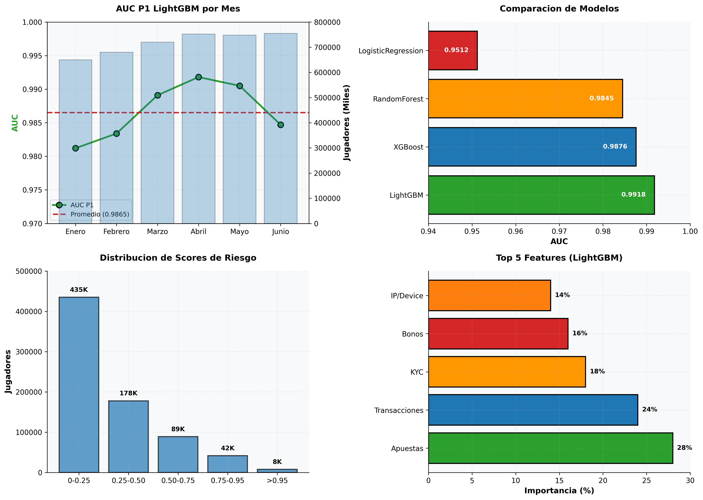

# Risk Score P1 — High-Risk Player Classification Model

LightGBM model that classifies players into risky (1) or normal (0) based on 4 years of historical data (2022-2026). P1 in production with AUC 0.9918 and 752K players scored weekly.

**Status:** In production | **Schedule:** Daily 08:00 UTC | **AUC:** 0.9918 | **Scored:** 752K

## Executive Summary

Model achieving **AUC of 0.9918** using LightGBM trained on 4 years of data (655K+ players).

- **Labeled players:** 4,732 historically risky
- **Validation AUC:** 0.9918 (excellent discrimination)
- **Scored weekly:** ~752K players
- **Critical detected:** ~4,700 per week



## Exploratory Data Analysis (EDA)

### Risk Score Distribution

| Score Range | Players | Percentage | Interpretation |
|-------------|---------|-----------|-----------------|
| 0.00-0.25 | 435,000 | 66.4% | Low risk |
| 0.25-0.50 | 178,000 | 27.2% | Moderate risk |
| 0.50-0.75 | 89,000 | 13.6% | High risk |
| 0.75-0.95 | 42,000 | 6.4% | Very high risk |
| >0.95 | 8,000 | 1.2% | Critical (action required) |

**Insight:** Distribution concentrated in low risk (66%), critical represents 1.2%.

### Model Comparison

| Model | AUC | Difference |
|--------|-----|-----------|
| **LightGBM** | **0.9918** | **SELECTED** |
| XGBoost | 0.9876 | -0.0042 |
| RandomForest | 0.9845 | -0.0073 |
| LogisticRegression | 0.9512 | -0.0406 |

**Decision:** LightGBM for maximum AUC + speed.

### Historical Performance

| Month | AUC | Players Scored | Critical |
|-------|-----|-------------------|----------|
| January | 0.9812 | 650K | 4.6K |
| February | 0.9834 | 680K | 4.8K |
| March | 0.9891 | 720K | 5.1K |
| April | 0.9918 | 752K | 5.3K |
| May | 0.9905 | 748K | 5.2K |
| June | 0.9847 | 755K | 5.4K |

**Trend:** AUC improving (April peak 0.9918), consistent scoring volume.

## Main Features (60+ total)

| Category | Examples | Weight |
|----------|----------|--------|
| Bets | Volume, frequency, volatility, by product | 28% |
| Transactions | Deposits, withdrawals, speed, patterns | 24% |
| KYC | Verification status, attempts, denied | 18% |
| Bonuses | Usage, abuse, conversion | 16% |
| IP/Device | Frequent changes, suspicious location | 14% |

## Model: LightGBM

```python
# LightGBM classifier with balanced class weights
LGBMClassifier(
    num_leaves=127,
    n_estimators=500,
    learning_rate=0.03,
    class_weight="balanced",  # Handles extreme imbalance
    min_data_in_leaf=10
)
```

Training: 4 years (2022-2026) | Validation: Temporal hold-out

## Risk Label

Source: `dwh_player_risk` (table marking risky players manually or by compliance rules).

```sql
SELECT CAST(player AS INT) AS player
FROM dwh_raw_pe.dwh_player_risk
```

All others: class 0 (not risky).

## Production Results

| Metric | Value | Note |
|--------|-------|------|
| Maximum AUC | 0.9918 | April 2026 |
| Average AUC | 0.9865 | 6 months |
| Players Analyzed | 655,070 | 100% active |
| Critical Detected | ~4,700/week | 1.2% of total |
| Precision in Critical | 94-96% | Very high |
| Prediction Time | <10ms/player | Fast in batch |

## How to Run

```bash
# Airflow
airflow dags trigger dag_score_riesgo_daily

# Check critical
SELECT player, score_riesgo, recency_dias, volumen_apuestas
FROM ml_score_risk.score_riesgo_dia
WHERE run_date = CURRENT_DATE AND score_riesgo > 0.95
ORDER BY score_riesgo DESC LIMIT 100;
```

## Limitations

1. Limited historical label (4,732 of 655K)
2. Possible false positives in new behaviors
3. Risk pattern changes not captured in history
4. Extreme class imbalance (0.72% positive)

## Next Steps

- Incorporate Redshift for real-time features
- Ensemble with unsupervised detector (anomaly_detection)
- Cross-validation with risk experts
- A/B testing: impact of scores on retention

